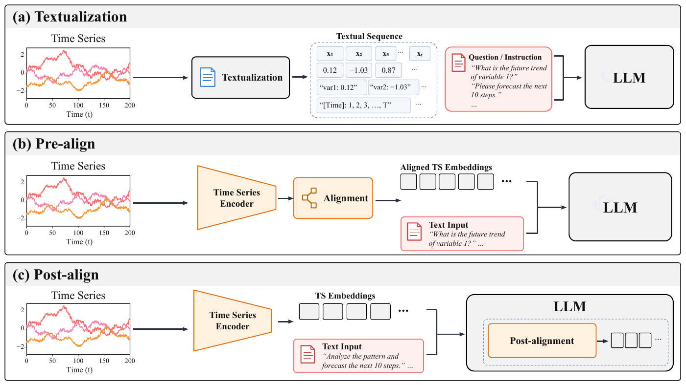
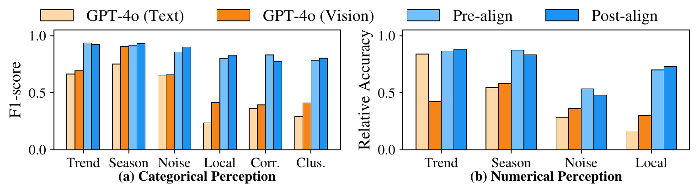
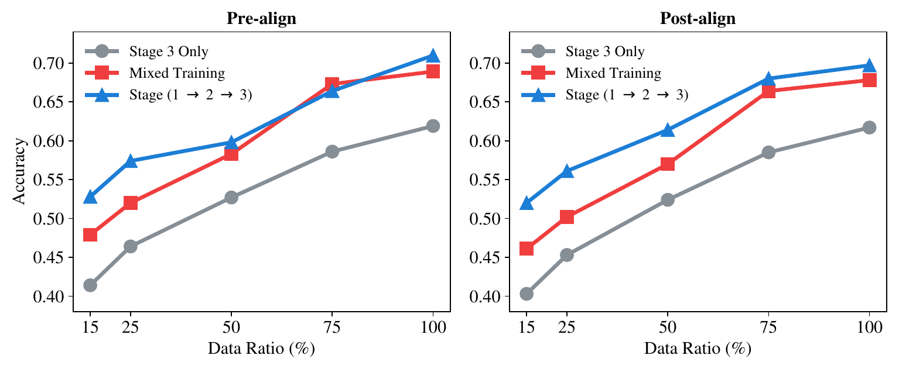
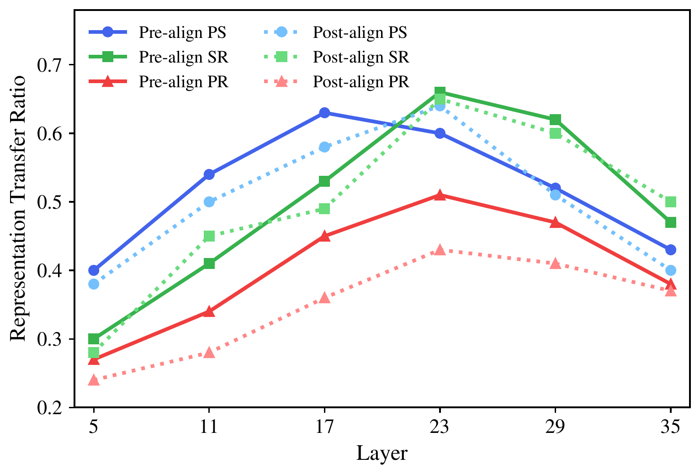
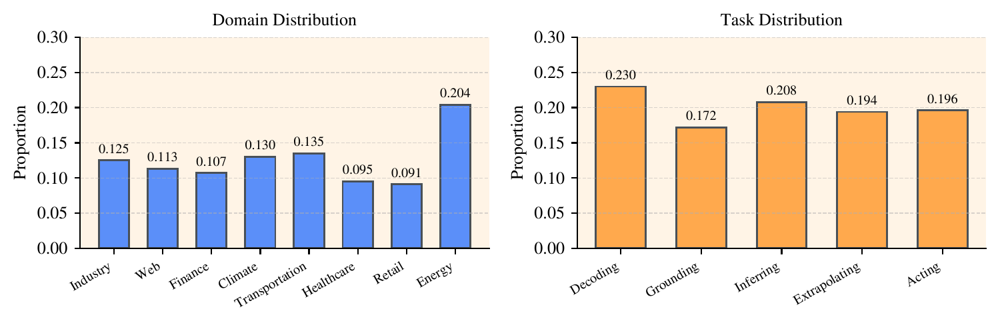

<div align="center">
  <h1>Perceive, Solve, Reason</h1>
  <h3>Progressive Capability Formation in Time Series-LLMs</h3>
  <p>
    <a href="#paper--citation">Paper (coming soon)</a> ·
    <a href="code/README.md">Code</a> ·
    <a href="docs/EVALUATION.md">Evaluation guide</a> ·
    <a href="docs/RESULTS.md">Full results</a>
  </p>
</div>

> **Release note.** This is an independently written, paper-inspired **reference implementation**. The tables and figures below come from the manuscript; the code has not reproduced those numbers. Original experiment code, datasets, and checkpoints are not included.

## Overview

Time series LLMs need more than a single downstream skill. This work studies whether capabilities develop through an ordered path:

<div align="center"><strong>Perceive → Solve → Reason</strong></div>

| Stage | Capability | Examples |
| --- | --- | --- |
| **1 · Perceive** | Understand temporal attributes | Trend, seasonality, noise, local patterns, correlations |
| **2 · Solve** | Execute standard time series tasks | Forecasting, imputation, anomaly detection, classification |
| **3 · Reason** | Use temporal evidence for decisions | Decoding, grounding, inferring, extrapolating, acting |

The paper compares ordered training against isolated stages and mixed supervision with **Pre-align** and **Post-align** architectures. It finds that Perceive helps Solve and that the complete path offers the strongest overall high-level reasoning results, especially when Reason training data are scarce.

<p align="center"></p>
<p align="center"><em>Figure: three time series input and alignment paradigms investigated in the paper.</em></p>

## Paper figures and findings

### Temporal perception

The first stage builds categorical and numerical understanding of basic time series patterns. The figure below compares the two alignment architectures with GPT-4o text and vision settings.

<p align="center"></p>

### Progressive reasoning

The advantage of ordered training is most visible with limited Stage 3 supervision. At **15%** of Reason training data, the full path reaches **0.528** for Pre-align and **0.520** for Post-align in the paper's scaling experiment.

<p align="center"></p>

### Why order matters

The paper also analyzes gradient dynamics and where stage-to-stage capability transfer appears across network layers. These are manuscript figures; the reference code does not regenerate them.

<p align="center">
  
</p>

## Selected paper results

**Stage 2 task solving.** Lower MSE and higher accuracy are better. The Stage 1 → 2 path improves most tasks over Stage 2 only.

| Architecture | Training path | Forecast MSE ↓ | Imputation MSE ↓ | Anomaly Acc. ↑ | Classification Acc. ↑ |
| --- | --- | ---: | ---: | ---: | ---: |
| Pre-align | Stage 2 only | 1.368 | 0.0136 | 0.682 | 0.567 |
| **Pre-align** | **Stage 1 → 2** | **1.328** | **0.0132** | **0.739** | **0.628** |
| Post-align | Stage 2 only | 1.423 | **0.0146** | 0.660 | 0.529 |
| **Post-align** | **Stage 1 → 2** | **1.286** | 0.0159 | **0.720** | **0.597** |

**Reasoning.** The full path improves the overall five-dimensional reasoning profile relative to Stage 3 only.

| Architecture | Training path | Decoding | Grounding | Inferring | Extrapolating | Acting |
| --- | --- | ---: | ---: | ---: | ---: | ---: |
| Pre-align | Stage 3 only | 72.2 | 68.5 | 61.3 | 57.2 | 50.7 |
| **Pre-align** | **Stage 1 → 2 → 3** | **82.5** | 79.1 | **70.7** | **65.4** | **57.2** |
| Post-align | Stage 3 only | 68.5 | 66.2 | 58.9 | 58.8 | 49.2 |
| **Post-align** | **Stage 1 → 2 → 3** | **79.0** | **79.4** | 64.2 | 66.7 | **61.4** |

On out-of-domain **MTBench**, Pre-align scores **67.24** on Weather MCQA and **68.19** on 7-day Finance 3-way classification; Post-align obtains **0.160** and **0.744** MSE on 7-day and 30-day Finance forecasting. See the [full comparison](docs/RESULTS.md).

### Which file corresponds to each table?

The CSVs contain **reported manuscript values**. [`psr-render-table`](src/psr/report.py) formats those CSVs for display; [`psr-evaluate`](src/psr/evaluate.py) and [`metrics.py`](src/psr/metrics.py) are the reference path for evaluating *new* checkpoints. See the [evaluation guide](docs/EVALUATION.md) for required datasets and limitations.

| Paper table / figure | Reported-value file | Reference evaluation entry point |
| --- | --- | --- |
| `progressive_capability` · Stage 2 task solving | [`task_solving_stage2.csv`](results/task_solving_stage2.csv) | `psr-evaluate` on Stage 2 JSONL |
| `reasoning_results` · five reasoning dimensions | [`reasoning_five_dimensions.csv`](results/reasoning_five_dimensions.csv) | `psr-evaluate` on five-dimensional MCQA JSONL |
| `reasoning_path` · binary, multiple-choice, open QA | [`reasoning_qa.csv`](results/reasoning_qa.csv) | `psr-evaluate` on QA JSONL |
| `ood_results` · MTBench | [`mtbench_ood.csv`](results/mtbench_ood.csv) | `psr-evaluate` after benchmark conversion |
| `perception_generalization` · TimeSeriesExam / CaTS-Bench | [`perception_generalization.csv`](results/perception_generalization.csv) | Benchmark-specific protocol still needed |
| `stage_saturation` · data scale and convergence | [`stage_saturation.csv`](results/stage_saturation.csv) | Exact split manifests still needed |
| `optimization_alignment` · gradient directions | [`optimization_alignment.csv`](results/optimization_alignment.csv) | Gradient analysis hook still needed |
| `frozen_encoder` · encoder ablation | [`frozen_encoder.csv`](results/frozen_encoder.csv) | Exact ablation setup still needed |
| `cate_num_comparison_detailed` · perception figure | [`perception_detailed.csv`](results/perception_detailed.csv) | Original categorical/numerical protocol still needed |
| `reasoning_data_scaling_detailed` · scaling figure | [`reasoning_data_scaling.csv`](results/reasoning_data_scaling.csv) | Exact scaling and mixed-training setup still needed |

```bash
# Print a reported manuscript table. This does not run a model.
psr-render-table --table progressive_capability
psr-render-table --all --output outputs/reported_tables.md
```

## Installation

The reference package requires Python 3.10+, PyTorch, Transformers, Accelerate, and a Qwen3-compatible environment. After cloning the repository, install a PyTorch build matching your CUDA driver before installing the package:

```bash
git clone https://github.com/EIT-NLP/PSR.git
cd PSR
conda env create -f environment.example.yml
conda activate perceive-solve-reason
# Install the CUDA-compatible PyTorch build for your machine.
python -m pip install -e .
```

The manuscript reports Qwen3-4B, **2 × NVIDIA A800**, bfloat16, AdamW, and an effective batch size of 32. Exact original package versions are unknown; see [reported settings](docs/REPRODUCIBILITY.md).

## Inference

With a reference checkpoint produced by the training pipeline, run a single time series question using [`examples/inference.json`](examples/inference.json):

```bash
psr-infer \
  --config configs/pre_align.yaml \
  --checkpoint outputs/pre_align/perceive-solve-reason \
  --input examples/inference.json \
  --max-new-tokens 32
```

The input is a JSON object with `series` (time steps × channels) and `prompt`. The command prints a JSON object containing the prompt and generated answer; add `--output outputs/inference.json` to save it. Set `model.channels` in the config to the series width. No pretrained weights are distributed here, so the checkpoint path above becomes available only after training or supplying your own compatible reference checkpoint. For batch scoring, use [Evaluation](docs/EVALUATION.md).

## Datasets

The paper combines several external resources across the three capability stages. The links point to verified dataset/release pages where available, or to the paper when a public download page could not be confirmed. Datasets and benchmark splits are **not** mirrored in this repository.

| Dataset | Used for | Public link |
| --- | --- | --- |
| **ChatTS** | Stage 1 perception; Stage 3 TSEvol and instruction following | [Training dataset](https://huggingface.co/datasets/ChatTSRepo/ChatTS-Training-Dataset) · [project](https://github.com/NetManAIOps/ChatTS) |
| **TSQA / Time-MQA** | Stage 2 forecasting, imputation, anomaly detection, classification; Stage 3 QA | [Time-MQA release hub](https://huggingface.co/Time-MQA) · [paper](https://aclanthology.org/2025.acl-long.1437/) |
| **TS Instruct / Chat-TS** | Stage 2 classification; Stage 3 reasoning | [TS Instruct dataset](https://huggingface.co/datasets/PaulQ1/TS_Instruct_Reasoning_V1) · [project](https://github.com/quinlanp/Chat-TS-Multi-Modal-Reasoning) |
| **TSCognition** | Stage 3 five-dimensional reasoning | [paper](https://arxiv.org/abs/2606.22126) · public dataset download link not confirmed |
| **TimeSeriesExam** | Out-of-domain perception evaluation | [dataset](https://huggingface.co/datasets/AutonLab/TimeSeriesExam) · [project](https://github.com/moment-timeseries-foundation-model/TimeSeriesExam) |
| **CaTS-Bench** | Out-of-domain temporal perception evaluation | [dataset](https://huggingface.co/datasets/mhfisher/CaTSBench) · [project](https://github.com/LuckerZOfficiaL/CaTS-Bench) |
| **MTBench** | Out-of-domain weather and finance evaluation | [paper](https://arxiv.org/abs/2503.16858) · public dataset download link not confirmed |

The paper also uses manually constructed and synthetic Stage 1 evaluation questions and its own Stage 2/3 splits. Their exact split files are not distributed here. See [DATA.md](docs/DATA.md) for source counts, the TSCognition source datasets, and known manuscript count inconsistencies.

## Data format

Training and evaluation use UTF-8 JSONL. Each line contains a time-by-channel numeric array and a prompt/answer pair:

```json
{"id":"sample-1","stage":"solve","task":"forecasting","series":[[1.0,2.0],[2.0,2.0]],"prompt":"Forecast channel 1. Return a JSON array.","answer":"[3.0]"}
```

The files under [`examples/`](examples/) illustrate the format only. Dataset sources and stage assignments are listed in [DATA.md](docs/DATA.md); public benchmark data and model weights must be obtained separately.

<p align="center"></p>
<p align="center"><em>Figure: domain and task distribution of the paper's TSCognition source.</em></p>

## Training and evaluation

From the repository root, run the complete Pre-align path:

```bash
accelerate launch -m psr.train --config configs/pre_align.yaml --stage perceive
accelerate launch -m psr.train --config configs/pre_align.yaml --stage solve --resume-from outputs/pre_align/perceive
accelerate launch -m psr.train --config configs/pre_align.yaml --stage reason --resume-from outputs/pre_align/perceive-solve
```

Use [`configs/post_align.yaml`](configs/post_align.yaml) for the Post-align model. The trainer also supports ordered ablations, including Stage 2 only, Stage 3 only, Stage 1 → 3, and Stage 2 → 3. Default configs point to tiny example files and are intended to show the interface. Full training requires real stage datasets and sufficient GPU memory.

```bash
psr-evaluate --config configs/pre_align.yaml \
  --checkpoint outputs/pre_align/perceive-solve-reason \
  --data data/eval/reasoning_dims.jsonl \
  --output outputs/eval/reasoning_dims_predictions.jsonl
```

The `data/eval/` path above is a placeholder. The evaluator writes a prediction JSONL and a `.metrics.json` file. For table-specific inputs and metric coverage, use the [evaluation guide](docs/EVALUATION.md). The implementation details and stage policies are in the [code guide](code/README.md).

## Repository layout

```text
assets/          Paper figure previews for the GitHub page
configs/         Pre-align and Post-align reference settings
docs/            Data, evaluation mapping, results, reproducibility
examples/        Tiny JSONL format examples
results/         CSVs transcribed from manuscript tables
src/psr/         Model, data, training, evaluation, report code
tests/           Lightweight behavior checks
```

## Paper & citation

The paper URL is pending: `PAPER_URL_TODO`. The manuscript's LaTeX source is not distributed in this repository. Replace the author and URL placeholders before citing:

```bibtex
@misc{perceivesolvereason2027,
  title  = {Perceive, Solve, Reason: Progressive Capability Formation in Time Series-LLMs},
  author = {AUTHOR_NAMES_TODO},
  year   = {2027},
  url    = {PAPER_URL_TODO}
}
```

## Contact

For questions about the paper or this reference repository, contact [qiuxin688@gmail.com](mailto:qiuxin688@gmail.com).

## License

The original reference code is available under the [MIT License](LICENSE). Paper figure previews and transcribed numerical results are outside that software license. See [CONTRIBUTING.md](CONTRIBUTING.md) for contribution guidance.
